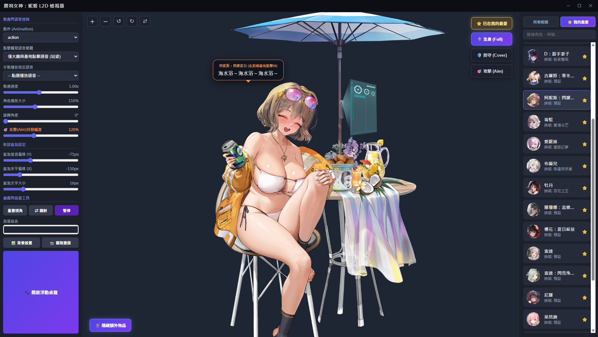
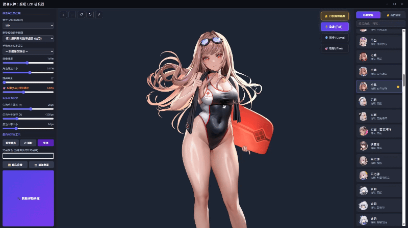
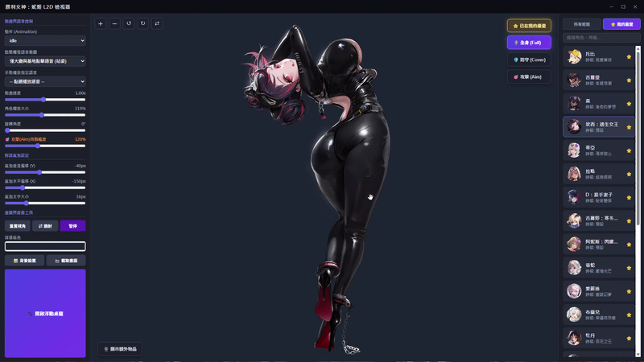
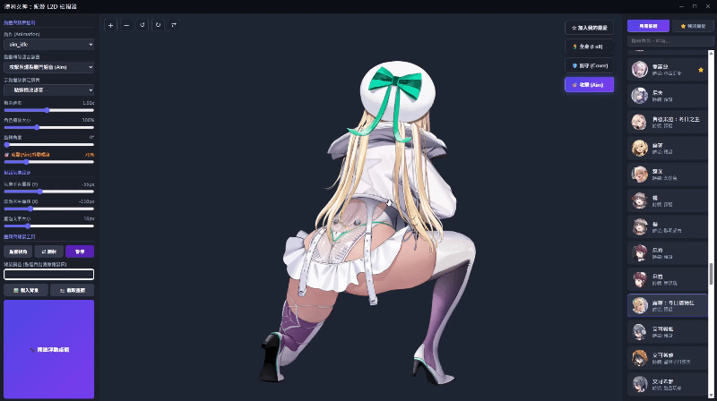
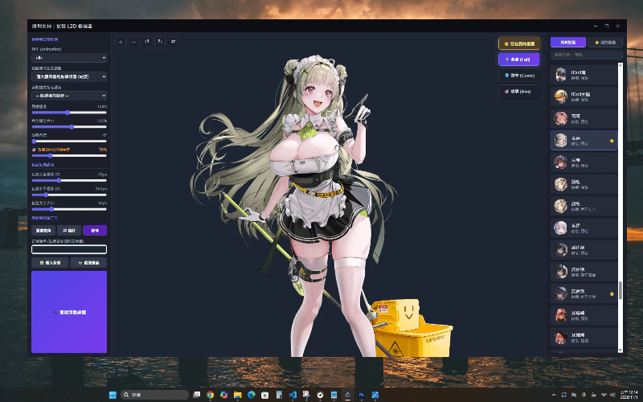
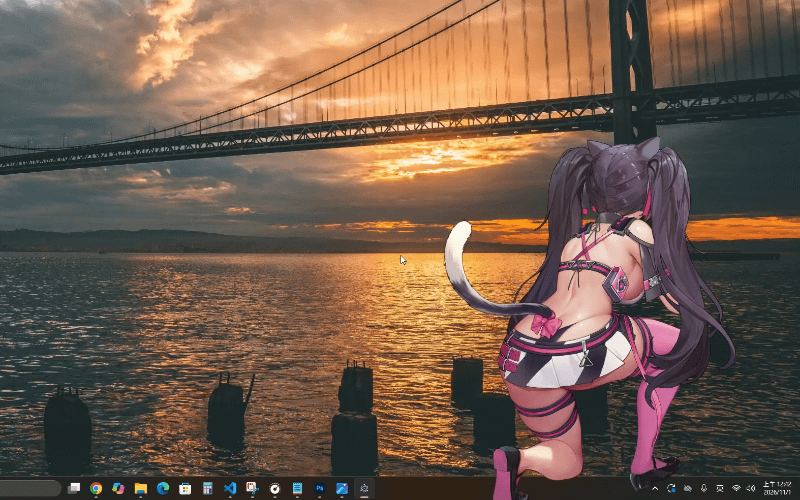
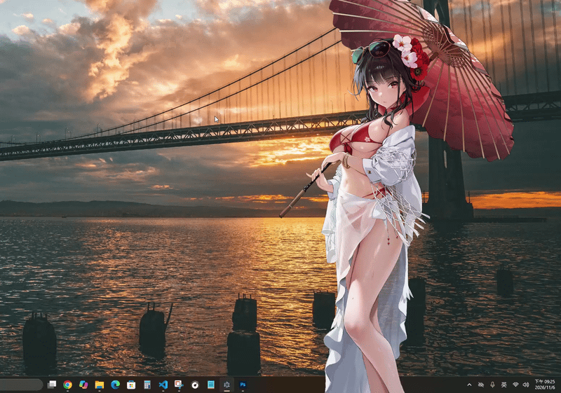
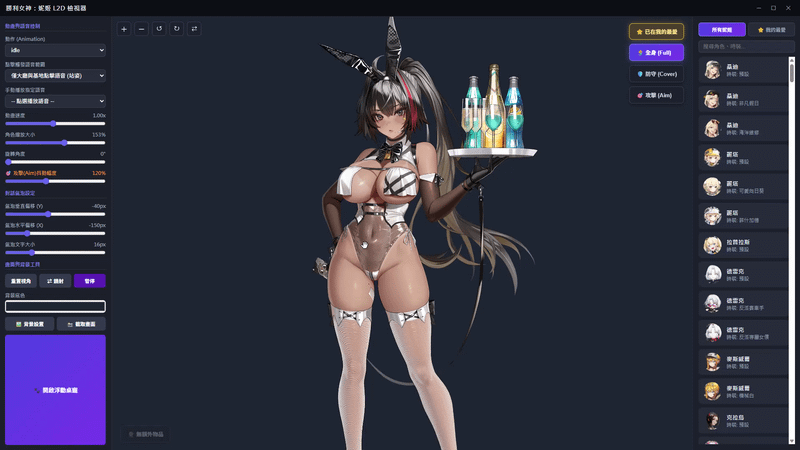

# 勝利女神：妮姬 L2D 檢視器 & 桌面寵物 (Nikke L2D Desktop Viewer)

**[ 繁體中文 | [English](./README_EN.md) ]**

這是一個基於 Electron 與 Spine WebGL 開發的《勝利女神：妮姬》(GODDESS OF VICTORY: NIKKE) Windows 動態立繪檢視器與透明浮動桌面寵物工具，完美相容 Spine 4.0 與 4.1 雙版本模型。



---

## ⚖️ 版權與免責聲明 (Disclaimer & Copyright)

1. **素材版權歸屬**：本專案中展示或使用的所有《勝利女神：妮姬》相關遊戲素材（包含但不限於 Spine 2D 骨骼立繪、角色圖像、語音音訊及台詞文本），其智慧財產權與版權均歸原開發商 **SHIFT UP Corp.** 與發行商 **Level Infinite** 所有，並非本專案作者所有。
2. **非營利性質**：本工具僅為玩家社群自製之非營利技術交流與粉絲向檢視工具，嚴禁將本專案或內含素材用於任何商業用途。
3. **支持正版遊戲**：本工具僅提供立繪與語音預覽，若想體驗完整的劇情演出、音樂與戰鬥樂趣，**請務必下載並至《勝利女神：妮姬》官方遊戲內體驗**（官方網站：[nikke-en.com](https://nikke-en.com/)）。
4. 若版權方認為本專案有任何不妥之處，請聯繫作者，我們將立即配合移除相關內容。

---

## ✨ 核心功能介紹 (Features)

### 1. 三大姿態無縫切換：全身 (Full) / 防守 (Cover) / 攻擊 (Aim)
支援每位妮姬的站姿、掩體防守與射擊瞄準三種獨立 Spine 姿態切換，並隨姿態自動切換對應的動作列表（Animation）與語音觸發池。



### 2. 點擊語音互動、即時口型同步 (Lip-Sync) 與對話氣泡
* **點擊觸發**：滑鼠點擊角色立繪即可隨機播放大廳或戰鬥語音，同步觸發專屬互動動作（如站姿 `action`、防守連續 3 次 `cover_reload` 填彈、攻擊 `aim_fire` 連射）。
* **智慧語音對嘴**：透過 Web Audio API 即時分析語音音量，自動控制角色嘴部開合（`talk_start` / `talk_end`），講完話自動閉嘴。
* **可自訂對話氣泡**：氣泡自動吸附於角色頭頂跟隨移動，並提供 X/Y 座標偏移與文字大小即時滑桿。
* **新增「🎡 顯示/隱藏額外物品」功能**：於展示區左下角提供額外物件開關按鈕，支援一鍵顯示或隱藏部分妮姬專屬的大型背景物件與配件（如坎西的珠寶櫃、毒蛇的販賣機等）。




### 3. 🎯 攻擊 (Aim) 模式專屬：射擊抖動幅度調整 & 長按連射
* **射擊抖動倍率 (0% ~ 300%)**：可自由調整開火 (`aim_fire`) 時的骨骼後座力與網格物理晃動幅度，並自動同步疊加特殊晃動軌道（如 `aim_fire_hair`、`aim_fire_hip`）。
* **長按立繪無限連射**：按住立繪不放即可進入持續掃射狀態，放開滑鼠後自動延續射擊再收槍回到待機。



### 4. 🐾 Windows 全螢幕無邊際透明桌寵模式
* **智慧滑鼠穿透**：一鍵隱藏主控台，讓妮姬直接置頂站在 Windows 桌面上！滑鼠移到透明區域時可直接穿透點擊後方桌面圖示或視窗；移到妮姬身上時則可拖曳位置或點擊互動。
* **定時主動觸發表情/動作**：桌寵模式下每隔 15~20 秒會自動隨機變換表情（`expression_X`）或執行換彈/射擊動作。
* **滑鼠游標跟隨瞄準（攻擊模式桌寵）**：在攻擊姿態下進入桌寵模式，妮姬會即時偵測全局滑鼠座標（`aim_x` / `aim_y`），隨著你的滑鼠游標轉動身體與槍口！
* **桌寵模式右鍵選單**：在浮動桌寵模式下，直接對妮姬點擊滑鼠右鍵即可彈出「姿態模式切換選單」，無須返回主控台即可隨時切換「全身 (Full) / 防守 (Cover) / 攻擊 (Aim)」，並具備自動縮放補償與螢幕邊界防呆鎖定。






### 5. 畫面工具與「⭐ 我的最愛」收藏系統
* **畫面自由變換**：支援縮放大小 (25%-250%)、360° 自由旋轉、左右鏡射翻轉、播放速度調整 (0.1x-2.0x)。
* **自訂背景與高畫質截圖**：內建 40 張預設背景素材，並提供獨立的「🖼️ 背景圖片設置」面板（支援背景載入、取消背景、X/Y 軸水平與垂直移動、縮放及 360° 旋轉即時預覽），亦可切換純色背景底色，並一鍵將當前合成畫面匯出為高畫質 PNG 截圖。
* **最愛收藏與設定自動記憶**：可將喜愛的妮姬與時裝加入「⭐ 我的最愛」分頁快速篩選；所有滑桿參數與視角位置皆會即時自動儲存。



---

## 🚀 下載與執行教學 (免安裝任何環境！)

本工具已內建自動化環境配置，**您不需要手動安裝 Node.js 或輸入任何指令**，下載後直接點擊批次檔即可使用！

### 方式 A：下載完整懶人包（推薦一般使用者，解壓即玩）
1. 點擊本頁面右側的 **Releases（發行版）**，下載最新版的 **`NikkeDesktopViewer_v1.0.rar`** (包含所有分割檔)。
2. 解壓縮至電腦任意位置。
3. 雙擊資料夾內的 **`啟動檢視器.bat`** 即可立即開啟檢視器！

### 方式 B：從專案主頁直接下載
1. 點擊本頁面右上角綠色的 **`<> Code`** 按鈕 ➔ 選擇 **`Download ZIP`** 並解壓縮。
2. 雙擊執行 **`啟動檢視器.bat`**：
   * **首次啟動時**：腳本會自動幫您下載並解壓縮運行核心（約需 1 分鐘，完全免手動安裝）。
   * **之後啟動**：雙擊 **`啟動檢視器.bat`** 即可秒開！

---

## 📅 更新日誌 (Changelog)

### 💃 妮姬收錄日誌 (Character Roster Log)
* **`2026/11/01`**：已收錄至 **2023 年為止**所有上線妮姬（含時裝）。
* **`2026/11/05`**：已收錄至 **2024 年為止**所有上線妮姬（含時裝）。

### 🛠️ 專案版本日誌 (Project Version History)
* **`Ver 1.0.0` (2026/11/01) — 初始版本發布**
* **`Ver 1.1.0` (2026/11/05) — 功能擴充與體驗優化**
  * **旋轉拖曳與跨姿態定位修正**：修正立繪在套用旋轉角度（0°~360°）時拖曳方向未與滑鼠同步的 Bug，並加入跨姿態切換自動縮放補償與螢幕邊界防呆鎖定。
  * **進階背景設置面板 & 內建背景庫**：新增獨立的「🖼️ 背景圖片設置」面板（支援背景載入、取消背景、X/Y 軸位移、縮放與 360° 旋轉即時預覽），並內建 40 張預設背景素材。
  * **新增「🎡 顯示/隱藏額外物品」功能**：於展示區左下角新增額外物件開關按鈕，支援一鍵顯示或隱藏部分妮姬的專屬大型背景物件（如珠寶櫃、販賣機等）。
  * **桌寵模式右鍵選單**：在浮動桌寵模式下，對妮姬點擊滑鼠右鍵即可彈出「姿態模式切換選單」，無須返回主控台即可直接切換「全身 (Full) / 防守 (Cover) / 攻擊 (Aim)」。
  * **動畫過渡優化**：修復桌寵模式下定時自動觸發動作時的部件殘影問題。

---

## 📁 專案結構說明

```text
NikkeDesktopViewer/
├── assets/characters/          # 存放預設背景圖片(.png)、各妮姬 Spine 立繪 (.skel/.atlas/.png)、語音與 config.json
├── css/style.css               # 介面與桌寵模式樣式表
├── js/
│   ├── app.js                  # UI 控制
│   ├── spineManager.js         # Spine 4.0/4.1 雙引擎渲染、多軌道動作與物理抖動核心
│   ├── lipSyncManager.js       # Web Audio 即時音量分析與自動對嘴模組
│   ├── settingsManager.js      # 使用者偏好設定即時記憶模組
│   ├── rightClickManager.js    # 桌寵模式右鍵事件模組
│   ├── interactionManager.js   # 點擊互動邏輯模組
│   ├── characterListManager.js # 角色最愛分頁管理模組
│   └── backgroundManager.js    # 加載背景模組
├── libs/                       # 本地 Spine WebGL 4.0 & 4.1 運行庫
├── lip_sync_blacklist.json     # 口型追蹤衝突例外設定表 (支援熱重載)
├── main.js                     # Electron 主程序 (無邊際透明視窗、穿透與全局游標追蹤)
├── index.html                  # 檢視器主介面
└── 啟動檢視器.bat               # Windows 一鍵啟動批次檔