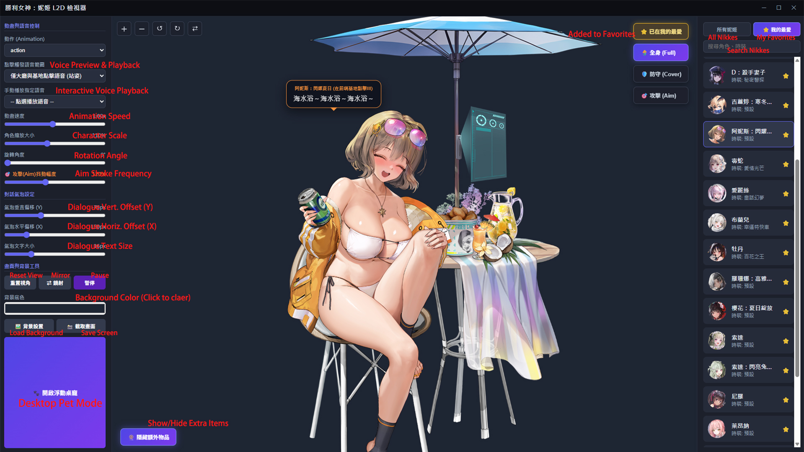
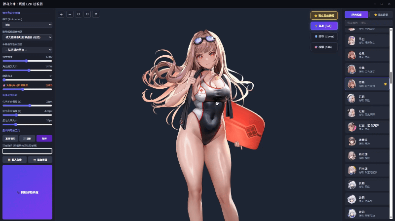
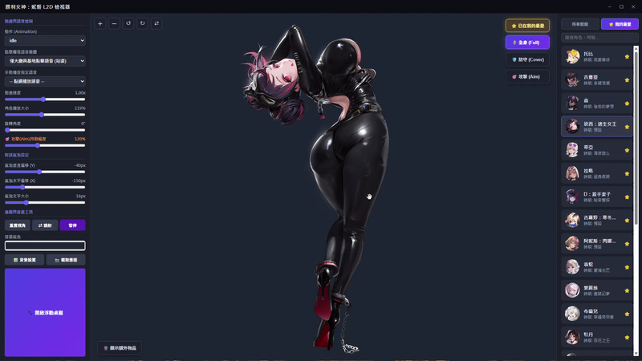
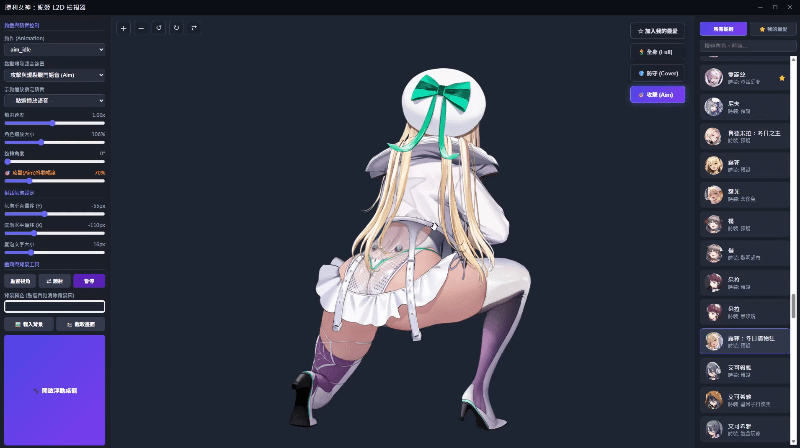
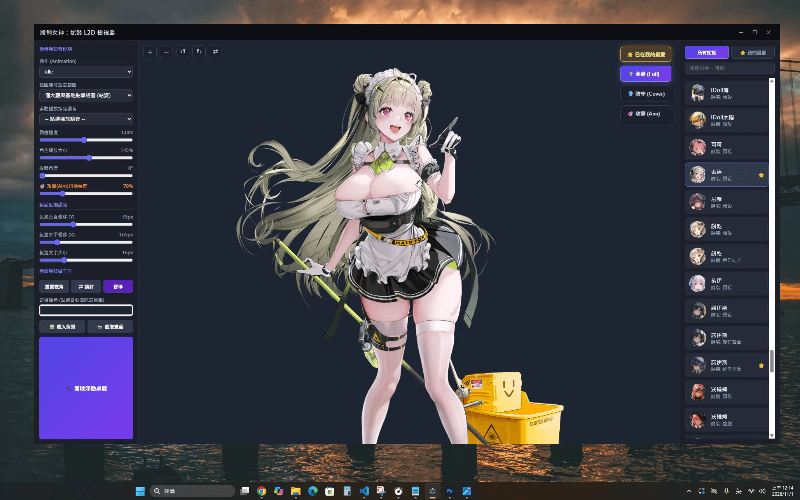
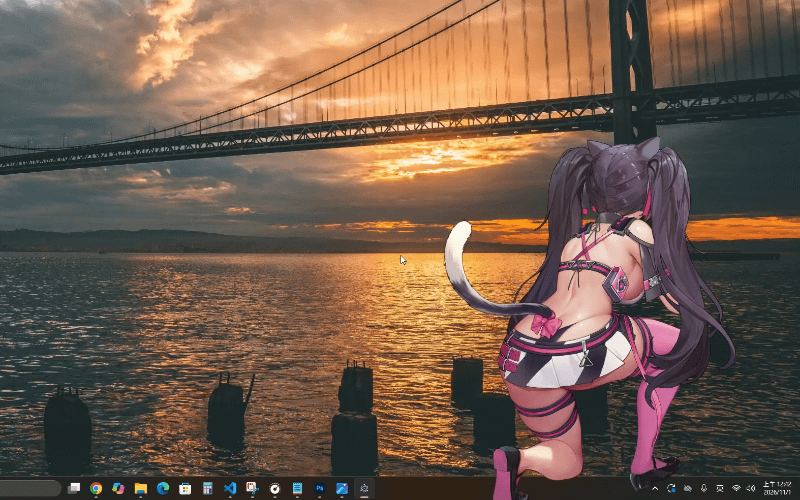
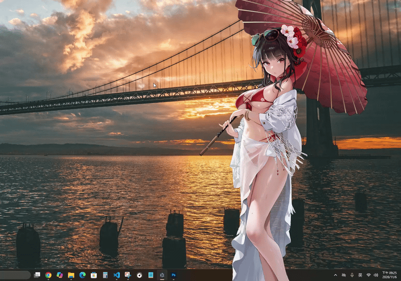
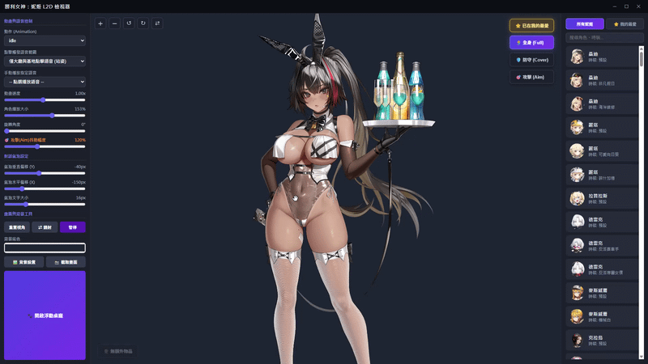

# GODDESS OF VICTORY: NIKKE - L2D Viewer & Desktop Pet

**[ [繁體中文](./README.md) | English ]**

A Windows Spine 2D Character Viewer and Transparent Desktop Pet application for *GODDESS OF VICTORY: NIKKE*, built with Electron and Spine WebGL (supporting both Spine 4.0 and 4.1 runtimes seamlessly).

---

## ⚖️ Disclaimer & Copyright

1. **Intellectual Property**: All *GODDESS OF VICTORY: NIKKE* game assets (including Spine 2D models, character illustrations, voice audio, and text lines) are the sole property and copyright of **SHIFT UP Corp.** and **Level Infinite**. I do not own any of these assets.
2. **Non-Commercial Fan Project**: This software is a fan-made, non-profit tool created purely for educational and preview purposes. Commercial use of this repository or its assets is strictly prohibited.
3. **Support the Official Game**: For the full story, music, and gameplay experience, **please download and play the official game *GODDESS OF VICTORY: NIKKE*** ([nikke-en.com](https://nikke-en.com/)).

---

## ✨ Key Features

### 1. Three Pose Modes: Full Body (Standing) / Cover / Aim
Switch seamlessly between Standing, Cover, and Aim postures for each character. The animation list and voice trigger pool automatically adapt to the active pose.

### 2. Click Voice Interaction, Real-time Lip-Sync & Speech Bubble
* **Interactive Voices & Animations**: Click on the character to play random voice lines and trigger corresponding animations (e.g., `action` in standing mode, triple `cover_reload` in cover mode, or `aim_fire` burst in aim mode).
* **Real-time Audio Lip-Sync**: Analyzes voice amplitude via the Web Audio API to drive `talk_start` and `talk_end` mouth animations in real time.
* ** customizable Speech Bubble**: Anchors dynamically above the character's head with adjustable X/Y offsets and font size sliders.
* **"🎡 Show/Hide Extra Items" Toggle**: Added a toggle button at the bottom-left of the stage to display or hide character-specific large background props and accessories (e.g., Quency's jewelry case, Viper's vending machine) with a single click.

### 3. 🎯 Aim Mode: Adjustable Recoil/Shake Multiplier & Hold-to-Fire
* **Aim Shake Slider (0% ~ 300%)**: Customize the recoil and physics jiggle intensity during `aim_fire`, automatically syncing sub-tracks such as `aim_fire_hair` and `aim_fire_hip`.
* **Hold to Continuous Fire**: Click and hold on the character in Aim mode for continuous firing.

### 4. 🐾 Borderless Transparent Windows Desktop Pet
* **Smart Click-Through**: Pin your favorite Nikke directly onto your Windows desktop! Transparent areas automatically pass mouse clicks through to your desktop icons and windows, while hovering over the character allows dragging and interaction.
* **Auto Idle Expressions**: Automatically plays random `expression_X` animations or reload/fire actions every 15–20 seconds in Desktop Pet mode.
* **Global Cursor Aim Tracking**: In Aim + Desktop Pet mode, the character dynamically tracks your mouse cursor across the screen (`aim_x` / `aim_y`), turning her body to aim wherever your cursor moves!
* **Desktop Pet Right-Click Context Menu**: Right-click directly on the character in Desktop Pet mode to open a pose-switching menu, allowing seamless transitions between Full Body (Standing), Cover, and Aim modes without returning to the main console, complete with automatic scale compensation and screen-boundary clamping.

### 5. Canvas Tools & Favorites System
* **Transform Controls**: Zoom (25%–250%), 360° Rotation, Horizontal Mirroring, and Animation Speed control (0.1x–2.0x).
* **Custom Background & PNG Screenshot**: Includes 40 built-in background presets and a dedicated "🖼️ Background Settings" popover panel (supporting load/clear background, real-time X/Y offset sliders, zoom, and 360° rotation preview), solid background color picker, and one-click high-resolution PNG screenshot export.
* **Favorites & Auto-Save**: Bookmark your favorite Nikkes and costumes under the "⭐ Favorites" tab. All slider settings and camera positions are saved automatically.

---

## 🚀 Quick Start (No Node.js Installation Required!)

You **do NOT need to manually install Node.js** or run any terminal commands!

### Option A: Download Full Portable ZIP (Recommended)
1. Go to the **Releases** section on the right side of this page and download **`NikkeDesktopViewer_v1.1.rar`** (including all split parts).
2. Extract the ZIP to any folder on your PC.
3. Double-click **`啟動檢視器.bat`** to launch immediately!

### Option B: Download Source ZIP
1. Click the green **`<> Code`** button at the top right ➔ Select **`Download ZIP`** and extract it.
2. Double-click **`啟動檢視器.bat`**:
   * **First Launch**: The script will automatically download and extract the portable Electron runtime into the folder (takes ~1 minute).
   * **Subsequent Launches**: Double-clicking **`啟動檢視器.bat`** will open the viewer instantly!

---

## 📅 Changelog

### 💃 Character Roster Log
* **`2026/11/01`**: Added all released Nikkes (including costumes) **up to 2023**.
* **`2026/11/05`**: Added all released Nikkes (including costumes) **up to 2024**.

### 🛠️ Project Version History
* **`Ver 1.0.0` (2026/11/01) — Initial Release**
* **`Ver 1.1.0` (2026/11/05) — Feature Expansion & UX Improvements**
  * **Rotation Dragging & Pose Transition Fix**: Fixed the cursor-dragging direction offset bug when the character is rotated (0°–360°), and added automatic scale compensation and screen-boundary clamping when switching poses.
  * **Advanced Background Settings Panel & Built-in Backgrounds**: Added a dedicated "🖼️ Background Settings" popover panel (supporting load/clear background, X/Y offset sliders, zoom, and 360° rotation with real-time preview) along with 40 built-in background presets.
  * **"🎡 Show/Hide Extra Items" Toggle**: Added a toggle button at the bottom-left of the stage to display or hide character-specific background props/objects (e.g., Quency's jewelry case, Viper's vending machine).
  * **Desktop Pet Right-Click Context Menu**: Right-clicking on the character in Desktop Pet mode now opens a context menu to switch directly between Full Body (Standing), Cover, and Aim modes without returning to the main console.
  * **Animation Transition Polish**: Fixed part ghosting/afterimage artifacts during periodic auto-triggered animations in Desktop Pet mode.